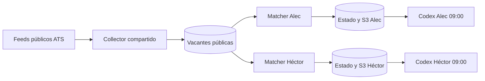

# ADR-001: separación de datos por candidato

Estado: aceptada para diseño local, pendiente de validación IAM antes de desplegar. Fecha: 2026-10-13.

## Decisión

Compartir solo el catálogo de vacantes públicas. Mantener tablas de estado, buckets de lotes y documentos, preferencias, manifiestos, locks e historial por candidato en recursos y roles independientes. La identidad de un candidato no recibirá permisos sobre recursos del otro. Los administradores de la cuenta AWS conservan acceso administrativo y por ello no se promete aislamiento frente a ellos.

## Controles

1. Identidades temporales con políticas por ARN exacto. No compartir claves IAM ni perfiles de navegador.
2. `candidate_id` obligatorio en políticas, manifiestos, locks, rutas y auditoría.
3. Pruebas negativas de lectura y escritura cruzada antes de aprobar despliegue.
4. S3 privado, cifrado y bloqueo público; DynamoDB independiente; TTL y retención documentados.
5. Una fallida comprobación de lote, fecha, checksum o permiso detiene la ejecución de ese candidato.

## Consecuencias

El código común puede revisarse una vez. La duplicación de recursos privados simplifica la verificación de permisos y genera un pequeño costo por recurso/solicitud que se medirá antes de desplegar.
