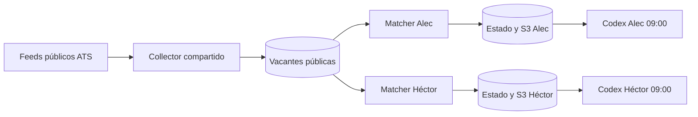

# ADR-001: separación de datos por candidato

Estado: aceptada; roles de Alec y Héctor desplegados. El rol de Alec se comprobó con STS y el de Héctor con simulación IAM de permisos permitidos/denegados; la sesión real desde el segundo equipo aún debe verificarse. Fecha: 2026-10-13; actualización: 2026-10-22.

## Decisión

Compartir solo el catálogo de vacantes públicas. Mantener tablas de estado, buckets de lotes y documentos, preferencias, manifiestos, locks e historial por candidato en recursos y roles independientes. La identidad de un candidato no recibirá permisos sobre recursos del otro. Los administradores de la cuenta AWS conservan acceso administrativo y por ello no se promete aislamiento frente a ellos.

## Controles

1. Ejecución cotidiana mediante sesiones temporales de roles con políticas por ARN exacto. El principal administrativo de origen conserva permisos amplios y no debe usarse como identidad efectiva del cliente diario. No compartir claves IAM ni perfiles de navegador.
2. `candidate_id` obligatorio en políticas, manifiestos, locks, rutas y auditoría.
3. Pruebas negativas con fixtures antes de desplegar; simulación IAM y rechazo de `AssumeRole` al principal de Alec tras el despliegue de Héctor. Completar pruebas reales desde el rol asumido en el segundo equipo antes de activar su ejecución diaria.
4. S3 privado, cifrado y bloqueo público; DynamoDB independiente; TTL y retención documentados.
5. Una fallida comprobación de lote, fecha, checksum o permiso detiene la ejecución de ese candidato.

## Consecuencias

El código común puede revisarse una vez. La duplicación de recursos privados simplifica la verificación de permisos y genera un pequeño costo por recurso/solicitud que se medirá antes de desplegar.
